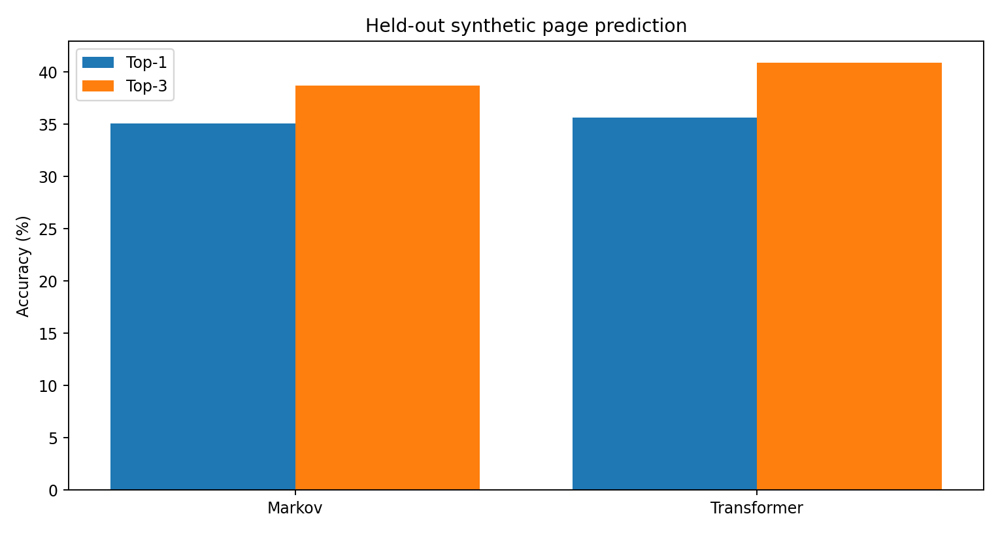
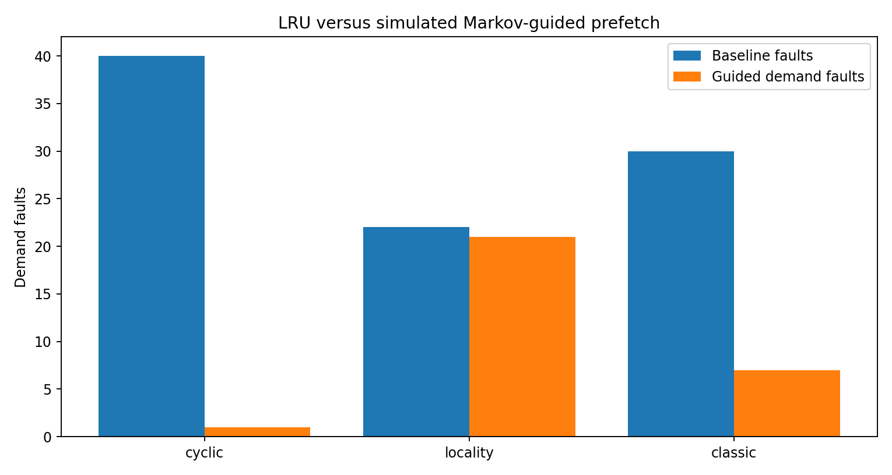
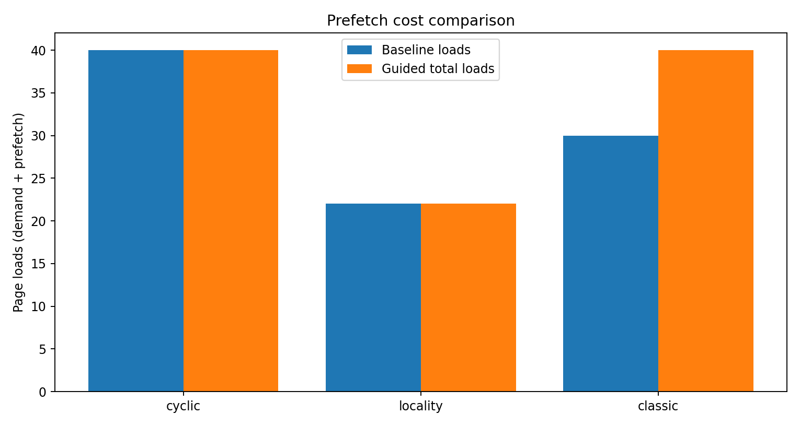

# CP7.2 — Module 2 Memory Evaluation

## Page prediction (held-out synthetic data)
- Markov Top-1: 35.07%; Top-3: 38.68%.
- Transformer Top-1: 35.64%; Top-3: 40.88%.
- Sequential traces repeat by design; 100% sequential accuracy should not be interpreted as generalization.

## Simulated prefetch evaluation
| Workload | Baseline demand faults | Guided demand faults | Guided prefetch loads | Guided total loads |
|---|---:|---:|---:|---:|
| cyclic | 40 | 1 | 39 | 40 |
| locality | 22 | 21 | 1 | 22 |
| classic | 30 | 7 | 33 | 40 |

- Prefetching is simulated; actual OS-level prefetch and page protection are not implemented.
- Demand-fault reductions are not equivalent to reductions in total page-loading work.

## Memory pressure forecasting
- Source: live_logs/baseline.csv; chronological 70/30 split; 18 held-out observations.
- MAE: 0.0743 percentage points; MSE: 0.0084 squared percentage points.
- This is a short single-session log and is not a broad validation dataset.

## Suspected memory leak detection
- Fixed labeled synthetic traces: 20; TP=10, TN=10, FP=0, FN=0.
- Accuracy: 100.00%; precision: 100.00%; recall: 100.00%; F1: 100.00%.
- Sustained RSS growth is a leak-risk signal, not proof of a genuine memory leak.

## Conclusions and limitations
- The action layers issue simulated directives; RESTART_PROCESS does not restart an OS process.
- The predictive prefetch experiment does not enforce PROTECT decisions.
- Synthetic workloads and short live telemetry limit generalization; larger independent datasets are future work.
