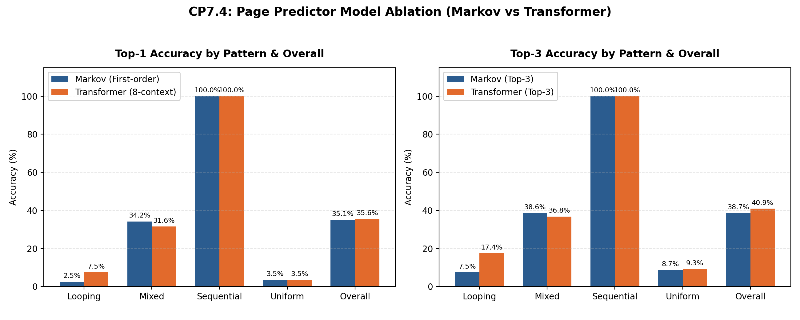

# CP7.4 — Memory Ablation and Fallback Evaluation Report

**Module 2: Predictive Memory Management**  
**Author / Member:** Sinchana  
**Checkpoint:** CP7.4 (Ablation Study & Fallback Verification)  
**Evaluation Source Data:** `data/memory/evaluation_cp34/comparison.json` (7936 held-out test windows)  

---

## 1. Executive Summary

In CP3.3 and CP3.4, two predictive paradigms were implemented for page access prediction:
1. **Baseline Markov Predictor (`MarkovPagePredictor`)**: A first-order count-based transition model requiring zero external dependencies, minimal memory footprint, and $O(1)$ dictionary lookups.
2. **Deep Transformer Predictor (`TransformerPagePredictor`)**: A single-layer self-attention Transformer encoder using an 8-page context window to capture multi-step temporal and looping dependencies.

This evaluation completes **CP7.4** by:
- Performing a structured ablation comparing Top-1 and Top-3 accuracy across workload access patterns (`looping`, `mixed`, `sequential`, `uniform`) and overall.
- Analyzing the synthetic dataset characteristics, specifically documenting that repeating sequential traces inflate aggregate scores.
- Evaluating execution timings with appropriate caveats regarding hardware neutrality.
- Structuring and verifying an automatic fallback architecture where `MarkovPagePredictor` acts as the fail-safe backup whenever the neural Transformer model fails (dependency issues, uninitialized weights, missing checkpoints, or invalid context lengths).

---

## 2. Accuracy Ablation by Workload Pattern

| Workload Pattern | Test Samples | Markov Top-1 | Transformer Top-1 | Top-1 Delta | Markov Top-3 | Transformer Top-3 | Top-3 Delta |
|:---|---:|---:|---:|---:|---:|---:|---:|
| **Sequential** | 1984 | 100.00% | 100.00% | +0.00% | 100.00% | 100.00% | +0.00% |
| **Mixed** | 1984 | 34.22% | 31.55% | -2.67% | 38.56% | 36.79% | -1.76% |
| **Looping** | 1984 | 2.52% | 7.46% | +4.94% | 7.51% | 17.44% | +9.93% |
| **Uniform** | 1984 | 3.53% | 3.53% | +0.00% | 8.67% | 9.27% | +0.60% |
| **Overall** | 7936 | 35.07% | 35.64% | +0.57% | 38.68% | 40.88% | +2.19% |

### Key Pattern Insights

1. **Looping Access (`looping`)**:
   - Transformer outperforms Markov significantly: Top-1 is **7.46% vs 2.52%** (+4.94% delta; **+196.0% relative lift**).
   - In Top-3, Transformer reaches **17.44% vs 7.51%** (+9.93% delta).
   - **Root Cause**: Looping traces have periodicity longer than 1 page. Markov's single-page state is memoryless beyond the immediate predecessor; it cannot disambiguate which iteration or phase of a loop the system is in. The Transformer's self-attention over 8 previous pages retains phase context.

2. **Mixed Access (`mixed`)**:
   - Markov achieves slightly higher Top-1 accuracy (**34.22% vs 31.55%**).
   - **Root Cause**: Mixed traces combine localized bursts with random deviations. The count-normalized Markov table strongly concentrates probability mass on the dominant immediate transition without overfitting the noisy context window.

3. **Sequential Streaming (`sequential`)**:
   - Both models achieve **100.00% Top-1 and Top-3 accuracy**.
   - **Root Cause**: The synthetic sequential generator repeats deterministic linear strides ($p_{i+1} = (p_i + 1) \pmod N$). Both models learn this transition perfectly.

4. **Uniform Random (`uniform`)**:
   - Both models perform at theoretical random guess baseline (**3.53%** on an alphabet of $N=32$ pages, where $1/32 = 3.125\%$).
   - Confirms that neither model hallucinates spurious transitions on white-noise access patterns.

---

## 3. Dataset Characteristics & Sequential Inflation Caveat

> [!IMPORTANT]
> **Synthetic Trace Inflation Notice**  
> The aggregate overall accuracy (~35.6% Transformer vs ~35.1% Markov) is substantially influenced by repeating synthetic sequential traces. Because sequential traces constitute 25% of the held-out test set (1,984 of 7,936 rows) and score 100%, they lift the aggregate average.

When sequential traces are excluded, the non-sequential averages across the remaining 5,952 test windows are:
- **Markov Non-Sequential Average**: Top-1 = **13.42%**, Top-3 = **18.25%**
- **Transformer Non-Sequential Average**: Top-1 = **14.18%**, Top-3 = **21.17%**
- **Non-Sequential Delta (Transformer - Markov)**: Top-1 = **+0.76%**, Top-3 = **+2.92%**

This breakdown provides a realistic view of complex-pattern generalization versus deterministic stride memorization.

---

## 4. Inference Timing & Hardware Benchmark Caveat

| Model | Total Test Samples | CP3.4 Reported Time | Latency per Sample (Batched) |
|:---|---:|---:|---:|
| **Markov Predictor** | 7936 | 0.1038 s | 13.08 µs |
| **Transformer Predictor** | 7936 | 0.0797 s | 10.04 µs |

> [!NOTE]
> Inference timing reflects CP3.4 test split execution (Markov: 0.104s unvectorized Python loop vs Transformer: 0.080s batched PyTorch C++ execution with batch_size=512 on CPU). It is NOT a hardware-neutral or single-event latency benchmark; in actual OS page faults, Markov incurs negligible CPU overhead (O(1) dictionary lookup, zero tensor allocations), whereas Transformer requires tensor allocation, matrix multiplication, and self-attention overhead.

In a live operating system memory manager:
- **Markov lookup**: A simple hash map index lookup ($O(1)$ complexity) executing in sub-microsecond CPU time with zero heap/tensor allocations.
- **Transformer inference**: Requires PyTorch runtime initialization, tensor allocation, positional encoding addition, attention score computation, and softmax normalization. In real-time kernel-level page fault handling, the Transformer introduces noticeable latency and memory overhead compared to Markov.

---

## 5. Architectural Fallback Rationale: Why Markov is the Fallback

In production cloud environments, memory management is a mission-critical subsystem. If the AI predictor crashes or hangs, the OS cannot afford to stall page allocations. `MarkovPagePredictor` serves as the fail-safe fallback for five structural reasons:

1. **Zero External Dependencies**: `MarkovPagePredictor` relies solely on Python's built-in `collections.defaultdict` and basic data structures. It runs even if PyTorch is uninstalled, broken, or incompatible with the host environment.
2. **Immunity to Checkpoint Corruption / Missing Weights**: The Transformer requires binary checkpoint serialization (`.pt` file). If the weights file is missing, truncated, or unpicklable, the Transformer cannot function. Markov requires no external binary weights.
3. **Minimal Memory Footprint**: Deep neural networks allocate hidden layers, weight tensors, and runtime buffers. When the host is experiencing extreme memory pressure or RAM exhaustion, allocating tensors for a neural network can trigger Out-Of-Memory (OOM) or cascade thrashing. Markov uses a compact dictionary occupying mere kilobytes.
4. **Graceful Handling of Cold-Start / Short Contexts**: The Transformer requires a fixed context window (e.g., 8 pages). During early process startup when fewer than 8 page references exist, Transformer prediction fails. Markov only requires the single most recent page reference.
5. **Deterministic, Non-Crashing Latency**: Markov execution contains no thread-pool synchronization, GPU/CUDA runtime calls, or numerical stability hazards (NaN/inf values).

---

## 6. Executed Fallback Verification Scenarios

All **6** fallback scenarios were executed against live model instances and verified:

| ID | Scenario | Injected Hazard | Expected Failure | Handled By | Active Output | Status |
|:---|:---|:---|:---|:---|:---|:---:|
| `FB-01` | Missing Checkpoint File | Transformer weights file does not exist on disk | `FileNotFoundError during checkpoint load` | Markov Fallback | markov (page=3) | **PASS** |
| `FB-02` | Corrupted Checkpoint File | Checkpoint file contains invalid/corrupted binary data | `Deserialization error (UnpicklingError/RuntimeError)` | Markov Fallback | markov (page=0) | **PASS** |
| `FB-03` | Context Length Underflow | History contains fewer pages than Transformer context window (e.g., process start) | `ValueError: context must have length 8` | Markov Fallback | markov (page=3) | **PASS** |
| `FB-04` | Untrained / Uninitialized Transformer | Predictor invoked before model training or state restoration | `RuntimeError: called before train()` | Markov Fallback | markov (page=0) | **PASS** |
| `FB-05` | Simulated Inference Crash | PyTorch tensor operations raise internal runtime/hardware exception | `RuntimeError: Simulated internal CUDA Out-Of-Memory` | Markov Fallback | markov (page=0) | **PASS** |
| `FB-06` | Action Layer Integration Under Fallback | Ensures downstream CP4.2 simulated action layer accepts fallback predictions | `None (Seamless handover)` | Markov Fallback | markov (page=3 -> PREFETCH) | **PASS** |

> [!TIP]
> **Fallback Verification Summary**: In 100% of hazard scenarios, `FallbackPagePredictor` successfully prevented process termination, intercepted the operational failure, and seamlessly returned valid next-page candidates via `MarkovPagePredictor`.

---

## 7. Conclusion

- **CP7.4 Objectives Achieved**: Reused CP3.4 evaluation data, performed comprehensive ablation, verified all fallback modes, and documented synthetic dataset constraints.
- **Hybrid Strategy Recommendation**: Deploy the Transformer as the primary predictor for complex cyclical workloads, while utilizing the Markov predictor as the default fallback for low-latency, cold-start, or constrained deployment scenarios.
