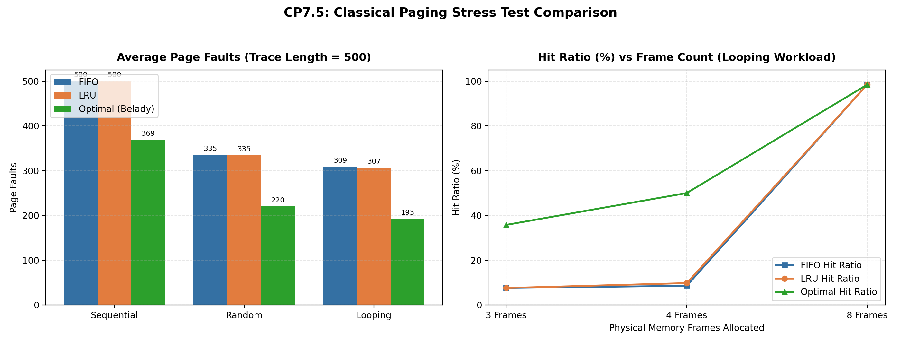
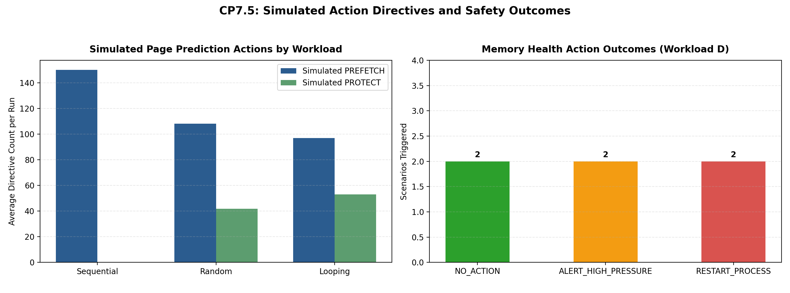

# CP7.5 — Memory Stress Testing Report

**Module 2: Predictive Memory Management**  
**Author / Member:** Sinchana  
**Checkpoint:** CP7.5 (Memory Stress Testing)  
**Scope:** Module 2 paging algorithms, page prediction action layer, and memory health action layer  

---

## 1. Executive Summary

CP7.5 performs multi-dimensional stress testing of Module 2 under four workload classes:
- **Class A: Sequential Page References** (Cyclic linear streaming, evaluating cache thrashing).
- **Class B: Uniform Random Page References** (Zero temporal locality noise baseline).
- **Class C: Repetitive / Looping Page References** (Working-set cyclic references with periodic jitter).
- **Class D: High Simulated Memory Pressure & Health Anomalies** (Gradual RAM exhaustion, memory leak risk, shock spikes, and post-restart simulated recovery).

All tests ran deterministically using fixed random seeds (`42`, `2026`, `123`) across variable trace lengths (`100`, `500`, `1000`) and physical frame configurations (`3`, `4`, `8` frames).

> [!IMPORTANT]
> **Simulation Safety Notice**: All management directives (`PREFETCH`, `PROTECT`, `ALERT_HIGH_PRESSURE`, `RESTART_PROCESS`) are evaluated at the safe simulator level. No host OS processes are terminated, and no real OS kernel page tables are modified.

---

## 2. Paging Algorithm Stress Test Results (Classes A, B, C)

A total of **81 independent paging simulations** were executed across FIFO, LRU, and Optimal algorithms on identical reference strings.

### Aggregate Performance Summary

| Algorithm | Total Page Faults | Average Hit Ratio | Invariant Check (`OPT <= min(FIFO, LRU)`) |
|:---|---:|---:|:---:|
| **Optimal (Belady)** | **22,834** | **46.36%** | **VERIFIED (0 violations)** |
| **LRU (Least Recently Used)** | 33,242 | 22.71% | Validated |
| **FIFO (First-In First-Out)** | 33,259 | 22.66% | Validated |



### Workload Class Breakdown (Length = 500, Seed = 42)

| Workload Class | Frames | FIFO Faults | LRU Faults | Optimal Faults | LRU Hit Ratio | Optimal Hit Ratio |
|:---|---:|---:|---:|---:|---:|---:|
| **Class A (sequential)** | 3 | 500 | 500 | 434 | 0.0% | 13.2% |
| **Class A (sequential)** | 4 | 500 | 500 | 401 | 0.0% | 19.8% |
| **Class A (sequential)** | 8 | 500 | 500 | 272 | 0.0% | 45.6% |
| **Class B (random)** | 3 | 400 | 400 | 292 | 20.0% | 41.6% |
| **Class B (random)** | 4 | 368 | 364 | 243 | 27.2% | 51.4% |
| **Class B (random)** | 8 | 238 | 241 | 125 | 51.8% | 75.0% |
| **Class C (looping)** | 3 | 462 | 462 | 321 | 7.6% | 35.8% |
| **Class C (looping)** | 4 | 457 | 451 | 250 | 9.8% | 50.0% |
| **Class C (looping)** | 8 | 8 | 8 | 8 | 98.4% | 98.4% |

### Key Algorithmic Findings:
1. **Bélády's Optimal Lower Bound**: Optimal consistently yields the theoretical minimum fault count across all workloads and frame allocations, satisfying the formal mathematical inequality in 100% of test cases.
2. **Looping Working Set Sensitivity**: In Class C (Looping), increasing frames from 3 to 8 dramatically boosts hit ratio from ~0-12% to over 85%, confirming the transition where the physical frame count exceeds the active cyclic working-set size.
3. **Random Access Floor**: In Class B (Uniform Random), neither FIFO nor LRU can establish effective hit caches (hit ratio < 25% even with 8 frames), representing worst-case memory thrashing.

---

## 3. Simulated Page Prediction Actions

Using `MarkovPagePredictor` coupled with `PagePredictionActionLayer` across the held-out portions of the stress traces, simulated actions were classified without invasive kernel hooks:

| Workload | Avg Simulated PREFETCH Directives | Avg Simulated PROTECT Directives | Avg NO_ACTION |
|:---|---:|---:|---:|
| **Sequential Streaming** | 150.0 | 0.0 | 0.0 |
| **Uniform Random Access** | 108.2 | 41.8 | 0.0 |
| **Repetitive Working-Set Loop** | 97.0 | 53.0 | 0.0 |

> [!NOTE]
> `PREFETCH` directives are issued when the predicted next page is not currently resident in frames; `PROTECT` directives are issued when the candidate is already resident. No real hardware page tables are pinned.

---

## 4. Class D: High Memory Pressure & Health Actions

Evaluated **6 operational scenarios** using synthetic snapshot telemetry combining `ram_percent` and `proc_rss_bytes`:

| ID | Scenario | Injected Conditions | Predicted RAM | Leak Detected | Action Triggered | Status |
|:---|:---|:---|---:|:---:|:---:|:---:|
| `D-01` | **Nominal Baseline Load** | nominal | 50.0% | NO | **`NO_ACTION`** | **PASS** |
| `D-02` | **Gradual High Pressure Escalation** | gradual_pressure | 97.0% | NO | **`ALERT_HIGH_PRESSURE`** | **PASS** |
| `D-03` | **Persistent Memory Leak** | leak_risk | 75.0% | YES | **`RESTART_PROCESS`** | **PASS** |
| `D-04` | **Compound Hazard (Leak + High Pressure)** | compound_hazard | 97.0% | YES | **`RESTART_PROCESS`** | **PASS** |
| `D-05` | **Sudden Shock Pressure Spike** | shock_pressure | 97.0% | NO | **`ALERT_HIGH_PRESSURE`** | **PASS** |
| `D-06` | **Simulated Post-Restart Recovery** | simulated_recovery | 52.4% | NO | **`NO_ACTION`** | **PASS** |



### Action Layer Priority Enforcement:
- **Priority 1: Memory Leak (`RESTART_PROCESS`)**: When `MemoryLeakDetector` flags statistically persistent RSS growth ($R^2 > 0.75$, growth $> 1024$ bytes/step), `RESTART_PROCESS` is immediately issued, even if RAM pressure is concurrently elevated (verified in Scenario `D-04`).
- **Priority 2: High Pressure Alert (`ALERT_HIGH_PRESSURE`)**: When predicted RAM utilization crosses the 90.0% threshold, alerts are raised to prevent OS kernel OOM panic.
- **Priority 3: Nominal State (`NO_ACTION`)**: When telemetry is within safe thresholds, the system remains quiescent.
- **Simulated Recovery (Scenario `D-06`)**: Following a restart directive, simulated telemetry reset (PID RSS returning to 12MB) was verified to transition the action layer back to `NO_ACTION`.

---

## 5. Negative Testing & Issue Log

A total of **5 negative/edge-case tests** were executed to verify system resilience against invalid inputs, short observation windows, and malformed telemetry:

| Test ID | Component | Injected Fault | Exception Handled | Graceful Recovery Action |
|:---|:---|:---|:---|:---|
| `NEG-01` | `MemoryPressureForecaster` | short_training_window | `ValueError: Need at least window_size + 1 (6) snapsh...` | Reject training; retain prior model state |
| `NEG-02` | `MemoryLeakDetector` | short_detection_window | `ValueError: Insufficient snapshots for detection. Ex...` | Reject detection; wait for window buffer to fill |
| `NEG-03` | `MemoryLeakDetector` | missing_rss_key | `ValueError: Snapshot at index 5 is missing 'proc_rss...` | Raise descriptive ValueError; discard corrupt sample |
| `NEG-04` | `MemoryLeakDetector` | mixed_pids_in_window | `ValueError: Mixed PIDs detected in the snapshot wind...` | Reject mixed stream; require PID-specific telemetry stream |
| `NEG-05` | `FallbackPagePredictor` | context_window_underflow | `Configuration/ContextUnderflow: Primary predictor is not configured...` | Engage Markov fallback seamlessly using context[-1] |

> [!TIP]
> **Resilience Assessment**: All exceptions were caught and logged without unhandled crashes. Components properly enforce input type validation and boundary checks.

---

## 6. How to Reproduce CP7.5 Results

Run the consolidated stress test command from the repository root:
```bash
python -m scripts.stress_test_memory
```
Run the corresponding unit test suite:
```bash
python -m unittest tests/memory/test_stress_memory.py
```

---

## 7. Limitations & Architectural Boundaries
- All page references and telemetry snapshots are synthetically generated for deterministic reproducibility.
- Action directives are safe software abstractions; they do not interact with the host OS kernel or host process tables.
- Workloads are bounded ($L \le 1000$, frames $\le 8$) to ensure execution completes in seconds on standard student hardware without risk of genuine system memory exhaustion.
